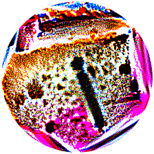
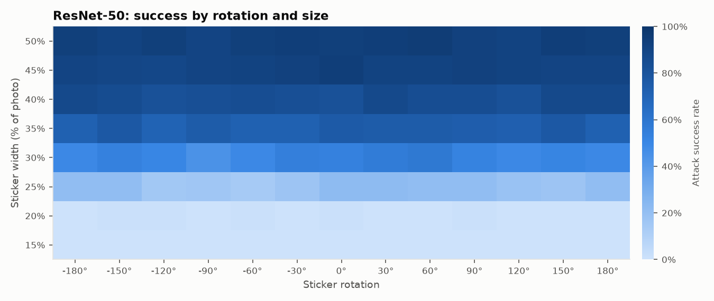

# adAI Sticker Lab

**Make a sticker that fools an AI, and learn why it works.**

adAI Sticker Lab is a pipeline, and soon an interactive website, that lets anyone
design a printable **adversarial sticker**: an image that makes a computer-vision
model see something that isn't there. Put a "toaster" sticker next to a banana and a
state-of-the-art classifier says *toaster*.

The project is a teaching tool for adversarial AI. You make an attack by hand, watch
it succeed or fail across rotations, sizes, lighting and different models, and see
*where the model is looking* when it gets fooled. That hands-on view shows something
abstract papers struggle to convey: high benchmark accuracy doesn't mean a model
understands what it sees.

> Built for AIPI 590 (Explainable & Responsible AI) at Duke. See the
> [roadmap](docs/ROADMAP.md) for the research question and milestones.

## First results

A round "toaster" sticker optimized against ResNet-50 (1,000 steps, about 2.5 minutes
on an Apple M5 Pro), tested on 300 **held-out** photos. In each photo the sticker
gets a random size (25–45% of the photo's width), rotation, position, tilt,
lighting, blur, noise and printer color drift:

<p align="center"></p>

| Condition | ResNet-50 says "toaster" | Correct label lost |
|---|---|---|
| No sticker | 0% | 0% |
| Random-noise sticker, same shape | 0% | 9% |
| **Adversarial sticker** | **67%** | **61%** |

- **Size matters, rotation doesn't.** Success jumps from near zero to over 50% once
  the sticker spans about 30% of the photo's width, at every rotation
  ([grid](docs/examples/toaster-resnet50/fig_grid.png)).
- **The attack lives in fine detail.** A 2-pixel blur drops success from 75% to 21%,
  and JPEG quality 40 drops it to 46%. Lighting, noise and color casts barely matter
  ([sweeps](docs/examples/toaster-resnet50/fig_sweeps.png)).
- **The model stares at the sticker.** The sticker covers 9% of the photo but gets
  60% of ResNet-50's Grad-CAM attention for "toaster", 6.5× its share of the image.
- **It mostly doesn't transfer.** On five models it never saw, success is 5–14%,
  but it still knocks out the correct label 11–35% of the time
  ([transfer](docs/examples/toaster-resnet50/fig_transfer.png)).



Reproduce with `uv run adai-sticker make --target toaster --transfer` (fixed seeds;
numbers may vary slightly across hardware).


## How it works

The pipeline follows six user-facing steps:

| Step | What you choose | Where it lives |
|---|---|---|
| 1. Pick a model to fool | ResNet-50, MobileNet V3, EfficientNet-B0, ConvNeXt-Tiny, ViT-B/16, or CLIP | `models.py` |
| 2. Pick a target label | Any of 1,000 ImageNet labels, or free text for CLIP, minus a [blocklist](docs/RESPONSIBLE_USE.md) | `labels.py` |
| 3. Design the look | Shape (circle, star, heart, …, or your own mask) and colors (free, a palette, or matched to a photo) | `masks.py`, `palette.py` |
| 4. Optimize | Gradient descent over thousands of simulated photos with random size, rotation, tilt, lighting, blur, noise and printer color drift | `transforms.py`, `optimize.py` |
| 5. Make it look normal | **Region mode:** keep your photo and confine the attack to stripes, a border or a painted region. **Blend mode:** nudge every pixel of your photo by at most ε | `sticker.py` |
| 6. Get results | Print-ready PNG and PDF sheet, and a report on how well it works and where the model looks | `evaluate.py`, `explain.py`, `report.py` |

Steps 4 and 5 run together: the cover photo is part of the optimization, so making
the sticker look normal doesn't destroy the attack. [Design notes](docs/DESIGN.md)
explains every major decision.

## Quick start

Requires Python 3.10–3.13 and [uv](https://docs.astral.sh/uv/) (or pip). A GPU
(Apple Silicon or CUDA) is strongly recommended. A full sticker takes about 3 minutes
on an M-series Mac and much longer on a CPU.

```bash
git clone git@github.com:haydn-s/adAI-sticker-pipeline.git
cd adAI-sticker-pipeline
uv sync                          # installs PyTorch, torchvision, open_clip, …
uv run adai-sticker fetch-data   # downloads Imagenette (~340 MB) into ./data
```

Make your first sticker:

```bash
uv run adai-sticker make --target toaster
```

Model weights download automatically the first time each model is used (20–350 MB
each, cached in `~/.cache`).

## Recipes

```bash
# A quick, lighter run (300 steps, smaller evaluation) to try things out
uv run adai-sticker make --target banana --quick

# Star-shaped, limited to a printable palette, and tested on every other model
uv run adai-sticker make --target goldfish --shape star --palette candy --transfer

# Region mode: keep your dog photo, put the attack in stripes with colors matched to the photo
uv run adai-sticker make --target toaster --cover-mode region --cover dog.jpg \
    --region stripes --region-amount 0.4 --palette auto

# Blend mode: your photo, with every pixel moved at most 16/255
uv run adai-sticker make --target pizza --cover-mode blend --cover dog.jpg --epsilon 0.063

# Fool several models at once (ensembles transfer better)
uv run adai-sticker make --target espresso --model resnet50 --model convnext_tiny --transfer

# CLIP accepts free-text targets (screened by the safety filter)
uv run adai-sticker make --target "a bowl of ramen" --model clip-vit-b-32

# Explore labels and models; see what's blocked and why
uv run adai-sticker labels guitar
uv run adai-sticker labels --blocked
uv run adai-sticker models

# Re-test a saved sticker on more models
uv run adai-sticker evaluate runs/<run> --transfer

# Physical test: score your own photos of the printed sticker
uv run adai-sticker eval-photos --photos my_photos/ --target toaster --model resnet50
```

`uv run adai-sticker make --help` lists every option.

## What you get

Every run writes a self-contained folder in `runs/`:

| File | Contents |
|---|---|
| `sticker.png`, `sticker_900px.png` | The sticker with transparency, at optimization and print resolution (3" at 300 dpi) |
| `print_sheet.pdf` | US-Letter sheet with the sticker at 4", 3", 2" and 1.5", with cut lines |
| `examples.png` | Held-out photos with the sticker, labeled *FOOLED* / *not fooled* with the model's prediction |
| `report.md` / `report.json` | Plain-language summary / every number behind it |
| `report_card.png` | All figures in one shareable image |
| `fig_controls.png` | Sticker vs. no sticker vs. random-noise sticker vs. cover photo |
| `fig_grid.png` | Success rate over rotation × size |
| `fig_sweeps.png` | Success under lighting, contrast, blur, noise, viewing angle, JPEG and color cast |
| `fig_transfer.png` | Success on models the sticker never saw |
| `fig_gradcam.png` | Where the model looks, with and without the sticker |
| `sticker.pt`, `request.json`, `assets/` | Everything needed to reload or re-evaluate the sticker |

## How a sticker is evaluated

All numbers come from **held-out photos** (Imagenette *val*) that the sticker never
saw during optimization, with fixed random seeds.

- **Controls.** The same scenes with no sticker and with a random-noise sticker of the
  same shape. The difference shows the effect of the optimization, not just of
  covering part of the image.
- **Success rate.** How often the model outputs the target label. **Correct label
  lost:** how often a photo the model got right becomes wrong. That second number
  matters even when the target isn't reached.
- **Rotation × size grid** and **seven condition sweeps**, each varying one factor
  from mild to severe.
- **Transfer** to models the sticker was not optimized against.
- **Attention share.** How much of the model's Grad-CAM attention lands on the
  sticker, compared with how much of the image it covers.

## Responsible use

Adversarial stickers are dual-use. The library **blocks target labels that could
harm people**: weapons, traffic and emergency signals, people and dehumanizing
labels, intimate clothing, drugs, and crime. The block is enforced in the core
pipeline, so every interface inherits it. Object detectors and face recognition are
deliberately out of scope. Read the full policy, threat model and its limitations in
[docs/RESPONSIBLE_USE.md](docs/RESPONSIBLE_USE.md).

## Project layout

```
src/adai_sticker/   the library and CLI (see docs/DESIGN.md for a module map)
tests/              fast offline tests (tiny stand-in model, synthetic photos)
docs/               design notes, responsible-use policy, roadmap
data/               downloaded datasets (git-ignored)
runs/               generated stickers and reports (git-ignored)
```

Run the tests with `uv run pytest`. They need no downloads and take about 15 seconds.

## Known limitations

- Results are measured in **simulation**. Printed stickers usually do worse;
  physical testing is milestone M3.
- The printer model is generic, not calibrated to a specific printer.
- Stickers are optimized with full access to the model (white-box). Transfer to other
  models varies and is reported separately.
- Background photos come from Imagenette's 10 categories.

More in [docs/DESIGN.md](docs/DESIGN.md#known-limitations).

## Acknowledgements and references

Builds on Brown et al., *Adversarial Patch* (2017); Athalye et al., *Synthesizing
Robust Adversarial Examples* (2018); Sharif et al., *Accessorize to a Crime* (2016);
and Selvaraju et al., *Grad-CAM* (2017). Uses PyTorch, torchvision,
[open_clip](https://github.com/mlfoundations/open_clip) and
[Imagenette](https://github.com/fastai/imagenette). Full list in
[docs/DESIGN.md](docs/DESIGN.md#references).

Licensed under Apache 2.0.
