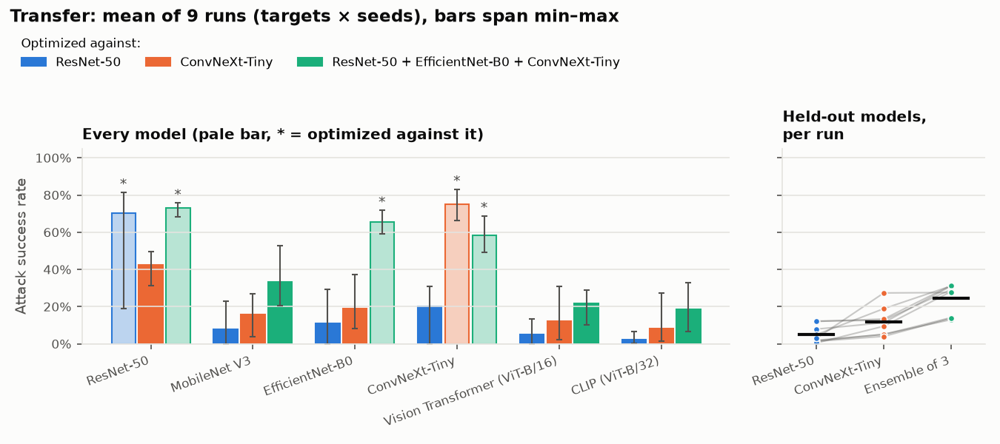

# Results

Evidence for the project's research question (see the [roadmap](ROADMAP.md)):

> How much attack success does an adversarial sticker give up as it is made to look
> more natural, and does that trade-off survive transfer to models it never saw?

Every number below comes from **held-out** photos (Imagenette *val*, 300 photos).
Conditions are randomized but seeded: random size (25–45% of the photo width), any
rotation, position, perspective tilt, lighting, contrast, blur, sensor noise and
printer color drift. All numbers are simulated; physical results will be added after
the photo shoot ([protocol](PHYSICAL_TESTING.md)).

## How the experiments were repeated

Both experiments were run for **3 targets × 3 seeds**:

- **Targets:** "toaster", "banana" and "jellyfish" (an appliance, a fruit and an
  animal). None of them is an Imagenette class, so no test photo is a free win, and
  the same 300 test photos serve every target.
- **Seeds** change everything random about *making* a sticker: its starting pixels,
  which 2,000 training photos are drawn, and the placements and lighting it trains
  under. The test photos and test conditions are fixed, so two runs differ only in
  the sticker.

Tables give the **mean over runs, with the min–max range in parentheses**. With three
seeds per target, a range says more than a confidence interval would. Comparisons
between two configurations are **paired**: both made for the same target with the
same seed, and reported as "ahead in *k* of 9 runs". As a yardstick for noise, a
success rate measured on 300 photos has a standard error of up to 3 points, so gaps
under about 5 points between two single numbers are within noise.

To keep GPU time bounded (about 3.5 hours on an M-series Mac), the repeats cover a
subset of configurations: stripes at 20/40/60% and blend at ε = 16/32/64 for
stealth; ResNet-50, ConvNeXt-Tiny and the three-CNN ensemble as transfer sources. The
toaster / seed 0 stickers are the ones from the original single run. Results outside
the subset (border regions, other amounts and budgets, a ViT-B/16 source) come from
that single run only and are labelled that way.

Reproduce with `uv run python experiments/replicate.py` (see
[experiments/README.md](../experiments/README.md)); `--summarize-only` re-pools the
finished runs, redraws the figures and prints every paired comparison quoted below.
Per-run numbers are in `docs/results/*/runs.csv`, per-cell means and ranges in
`docs/results/*/summary.csv`, and the original single run in
`docs/results/*/single_run_toaster_seed0.csv`.

## What held up

| Single-run finding (toaster, seed 0) | Across 3 targets × 3 seeds | Verdict |
|---|---|---|
| Fully adversarial stickers succeed about 70% of the time | 72% on average (53–80%); toaster is the hardest target (61%) | Held |
| No sticker that stays close to the photo (SSIM ≥ 0.7) reaches 5% | Blend ε = 16 (SSIM 0.73) reaches 19% for "jellyfish" (8% banana, 3% toaster) | **Did not hold**; toaster is the steep case |
| The best stealthy design (60% stripes) falls about 11 points short of a fully adversarial sticker | 11.5 points short on average; behind in 9/9 runs, by 0.3 to 20 points | Held |
| At equal similarity, stripes beat blend across the whole range | At SSIM ≈ 0.28 stripes lead in 9/9 runs (+15 points); at SSIM ≈ 0.5 they're even (+2 points, ahead in 3/9) | **Partly held**: only far from the photo |
| Blending saturates: ε 32 → 64 barely helps | +9 points on average, positive in 9/9 runs (toaster +6, banana +10, jellyfish +12) | **Did not hold** beyond toaster |
| Top-5 success climbs far faster than top-1 | Top-5 is 38–52 points above top-1 on average at every stealthy setting | Held |
| The stealthiest stickers do little beyond covering the scene | Blend ε = 16 adds 7 points of disruption over the cover photo alone (positive in 9/9 runs) | Held: little, but consistently more than nothing |
| Single-model stickers transfer weakly, and best to their closest relative | ResNet-50 sticker: 2–20% on the other models; ConvNeXt sticker: 8–43%. Each transfers best to the other in 8/9 and 9/9 runs | Held |
| Ensembles transfer much better | On the three models no source saw: 24% against 5% (ResNet-50 sticker) and 12% (ConvNeXt sticker); ahead of both in 9/9 runs | Held, but smaller (single run: 29–33%) and only 14% for jellyfish |
| ...at almost no cost on the models they were optimized against | ConvNeXt: 17 points below a ConvNeXt-only sticker, lower in 9/9 runs. ResNet-50: a median of 4 points lower, in 6/9 runs | **Did not hold** for ConvNeXt |
| CLIP drops the right label easily, so its numbers need the noise control | Noise sticker: 31% on CLIP against 4–16% elsewhere. The ensemble's 49% on CLIP is 19 points above it, in 9/9 runs | Held; the real effect is smaller than the single run's 27 points |

Two things a single run couldn't show:

- **Target matters far more than seed.** For one target and setting, the three seeds
  usually agree closely (median min–max range 3 points; the widest is toaster's fully
  adversarial sticker, 53–68%). Between targets, the same setting differs by 10–25
  points (blend ε = 64: 27% for toaster, 52% for banana). The single run happened to
  use the target on which blending works worst.
- **Optimization sometimes stalls.** In 4 of 63 stealth stickers the target's
  probability never rose above 1% during training (all three banana runs with 20%
  stripes, and one toaster blend ε = 16 run). One of 27 transfer stickers started so
  slowly that it fooled its own model on only 19% of photos (toaster, ResNet-50,
  seed 1); the other eight ResNet-50 stickers reached 68–81%. A single run can
  therefore misstate a configuration by tens of points. Stalled runs are kept in every
  mean and range below.

## 1. Stealth vs. strength

*Can a sticker look like a normal photo and still fool the model?*

The cover photo is a dog (an English springer from Imagenette val). Each point is a
separate sticker optimized for 600 steps against ResNet-50:

- **Stripes.** The photo is kept exactly, except in diagonal stripes covering
  *amount* of the sticker.
- **Blend.** Every pixel of the photo may change by at most ε/255.

Stealth is measured as **SSIM** to the original photo (1 = identical).

| Sticker | SSIM | Says the target: all runs | toaster | banana | jellyfish | Target in top 5 | Correct label lost |
|---|---|---|---|---|---|---|---|
| Fully adversarial (reference) | — | **72%** (53–80%) | 61% | 76% | 77% | 99% | 66% |
| Stripes, 20% | 0.66 | 11% (0–18%) | 17% | 0%† | 17% | 51% | 24% |
| Stripes, 40% | 0.45 | 45% (38–53%) | 39% | 53% | 43% | 95% | 40% |
| Stripes, 60% | 0.26 | **60%** (53–68%) | 56% | 66% | 59% | 98% | 54% |
| Blend, ε = 16/255 | 0.73 | 10% (0–19%) | 3% | 8% | 19% | 50% | 18% |
| Blend, ε = 32/255 | 0.51 | 34% (18–44%) | 22% | 42% | 38% | 86% | 32% |
| Blend, ε = 64/255 | 0.28 | 43% (26–59%) | 27% | 52% | 50% | 91% | 40% |
| *Cover photo alone (control)* | 1.00 | 0% | 0% | 0% | 0% | — | 11% |
| *Random-noise sticker (control)* | — | 0% | 0% | 0% | 0% | — | 9% |

Per-target columns are means over 3 seeds; their ranges are in `summary.csv`. The
last three columns are means over all 9 runs. † All three runs stalled (see finding 6).

**Findings**

1. **The trade-off is real, but its steepness depends on the target.** On every
   target, success falls as the sticker gets closer to the photo, for both designs,
   and no stealthy sticker beats the fully adversarial one made with the same seed
   (60% stripes came within a point once). Near the photo the targets split: at SSIM
   0.71–0.74 a blend sticker says "jellyfish" 19% of the time, "banana" 8% and
   "toaster" 3%. The single run's "nothing above SSIM 0.7 reaches 5%"
   describes toaster, not stickers in general.
2. **Stripes beat blend only far from the photo.** We compare at equal similarity by
   interpolating each run's stripes curve at the blend sticker's SSIM (same target and
   seed). At SSIM ≈ 0.28 (ε = 64), stripes lead by 15 points on average and in 9/9
   runs. At SSIM ≈ 0.5 (ε = 32) the two are even: +2 points, stripes ahead in only
   3/9 runs. For banana and jellyfish the curves cross. Border regions, the weakest
   design in the single run, were not repeated.
3. **Blending keeps paying off, just less per step than stripes.** Going from ε = 32
   to 64 adds 9 points on average and helps in 9/9 runs. Toaster's +6 was the smallest
   gain (+4 in the single run), which is why it looked saturated. Over a similar loss of
   similarity, stripes 40% → 60% add 15 points.
4. **"Almost fooled" comes long before "fooled".** At every setting the target makes
   the top five far more often than it wins. Blend at ε = 32 wins 34% of the time
   but is in the top five 86% of the time. A system that acts on top-5 candidates, or
   on a low-confidence threshold, is much easier to attack than headline accuracy
   suggests.
5. **The stealthiest stickers do a little more than cover the scene.** The cover photo
   alone makes ResNet-50 lose the correct label on 11% of photos (a random-noise
   sticker: 9%). Blend at ε = 16 raises that to 18%: 7 points beyond the cover photo,
   in 9/9 runs (range +1 to +11). The extra disruption grows as the attack becomes
   visible: 32% at ε = 32, 54% for 60% stripes. The single run (12–13% vs. 11%)
   understated it.
6. **The stealthiest settings are where optimization stalls.** All four stalled
   stickers came from the two stealthiest settings. Banana with 20% stripes stalled
   with every seed, and one toaster run at ε = 16 stalled. In these runs the target's probability stayed near
   0.1% for all 600 steps; working runs at the same settings peaked at 2–13%, and every
   other setting at 7% or more. In all three banana stripes runs the smoothness penalty
   fell steadily instead (0.26 → 0.10): the optimizer smoothed the stripes rather than
   attacking. No
   sticker at 40% or 60% stripes, ε ≥ 32 or full coverage stalled. The smaller the
   budget, the more the starting point matters.

**Caveats.** One cover photo, one attacked model (ResNet-50), 600 optimization steps
per sticker. Stripes became the default region because they did best in early tests,
so they're not an independent discovery. SSIM is a proxy for "looks normal"; a human
rating study would be the stronger measure. Three targets show that the trade-off's
shape varies by target, but not how it varies across all 1,000 classes.

**Single run only (toaster, seed 0).** Border regions did worst: 0%, 3% and 28%
success at 10%, 30% and 60% coverage (SSIM 0.81, 0.49, 0.16), below stripes at
similar similarity even though a 60% border changes more pixels than 60% stripes.
Other amounts and budgets are in `single_run_toaster_seed0.csv` and
[the single-run figure](results/stealth/fig_single_run_toaster_seed0.png).

## 2. Transfer and ensembles

*Does a sticker fool models it was never optimized against, and does optimizing
against several models at once help?*

In every run, each source gets one fully adversarial circle sticker, optimized for
1000 steps against the model(s) on the left and then tested on all six models. Starred
cells are models the sticker was optimized against; the rest are transfer. ViT-B/16
was not repeated as a source, because our attack can't fool it even with full access
(finding 5).

The right panel shows each run's mean success on the three models that no source saw
(MobileNet V3, ViT-B/16 and CLIP); a grey line joins the three stickers made for the
same target with the same seed.

| Optimized against | ResNet-50 | MobileNet V3 | EfficientNet-B0 | ConvNeXt-T | ViT-B/16 | CLIP | Held-out mean |
|---|---|---|---|---|---|---|---|
| ResNet-50 | **70%*** (19–81%) | 8% (0–23%) | 11% (0–29%) | 20% (0–31%) | 5% (0–13%) | 2% (0–7%) | 5% (0–12%) |
| ConvNeXt-Tiny | 43% (31–50%) | 16% (4–27%) | 19% (8–37%) | **75%*** (66–83%) | 12% (2–31%) | 8% (1–27%) | 12% (4–27%) |
| ResNet-50 + EfficientNet-B0 + ConvNeXt-T | **73%*** (68–76%) | 33% (21–53%) | **66%*** (59–72%) | **58%*** (49–69%) | 22% (10–29%) | 18% (7–33%) | **24%** (13–31%) |
| *ViT-B/16 (single run: toaster, seed 0)* | 0% | 0% | 0% | 0% | 1%* | 0% | — |

The held-out mean is over MobileNet V3, ViT-B/16 and CLIP. Per target:

| Held-out mean, optimized against | toaster | banana | jellyfish |
|---|---|---|---|
| ResNet-50 | 3% | 11% | 2% |
| ConvNeXt-Tiny | 19% | 12% | 5% |
| Ensemble of three CNNs | 29% | 31% | 14% |

Controls: with no sticker, no model says any of the three targets on any test photo
(0% in every column). A random-noise sticker of the same shape gets at most 1 photo
in 300. So every nonzero transfer number above is the sticker's doing.

**Findings**

1. **Single-model stickers transfer weakly, and best to their closest relative.** The
   ResNet-50 sticker fools ResNet-50 70% of the time but the other models only 2–20%
   on average; the ConvNeXt sticker transfers better, at 8–43%. Each transfers best to
   the other (ConvNeXt is a modernized ResNet): the ResNet-50 sticker in 8/9 runs, the
   ConvNeXt sticker in 9/9. Both transfer worst to the two vision transformers, ViT-B/16
   and CLIP.
2. **Ensembles transfer better, every time.** On the three models no source saw, the
   ensemble sticker averages 24%, against 5% for the ResNet-50 sticker and 12% for the
   ConvNeXt sticker. It beats the ResNet-50 sticker in 9/9 runs (by 11 to 28 points)
   and the ConvNeXt sticker in 9/9 (by 0.2 to 20 points; one run is a tie). The gain is
   smaller than the single run suggested and depends on the target: 29–31% for toaster
   and banana, 14% for jellyfish. Ensembling is still the usual way attackers get around
   not knowing which model is deployed, and why "we use a different model" is weak
   protection on its own.
3. **But the ensemble isn't free.** Spreading the sticker over three models costs some
   success on each. On ConvNeXt the ensemble sticker scores 58% against 75% for a
   ConvNeXt-only sticker: 17 points lower, in 9/9 runs (by 14 to 24 points). On
   ResNet-50 the cost is small: a median of 4 points, lower in 6/9 runs. The single
   run's "almost no cost" already hid a 14-point drop on ConvNeXt (69% vs. 83%).
4. **One slow start can swing a comparison.** The toaster ResNet-50 sticker made with
   seed 1 fooled ResNet-50 on only 19% of photos; its target probability peaked at 9%
   during training, against 37–60% for the other eight ResNet-50 stickers. That run
   supplies the 19% on ResNet-50 and most of the 0% minima in the ResNet-50 row, and
   it's why the ensemble "beats" the ResNet-50 sticker on ResNet-50 by 53 points once. Medians and paired counts keep it
   from dominating the summary.
5. **Our attack failed against ViT-B/16, even with full access to it (single run).** The
   sticker optimized against the vision transformer fooled it on 1% of photos. During
   optimization its target probability peaked at 7%; the CNN stickers peaked at 37–78%
   (the slow start above aside). This is a limitation of our settings, which were tuned on CNNs
   (learning rate, smoothness penalty, transformations). It isn't evidence that
   transformers are robust: the CNN ensemble's sticker fools ViT-B/16 on 22% of photos
   (10–29%) without ever seeing it, and in a separate quick run a CLIP sticker for "a
   bowl of ramen" fooled CLIP on 74% of photos. Published work reports successful patch
   attacks on ViTs with methods designed for them (e.g. Patch-Fool, Fu et al., ICLR
   2022).
6. **CLIP loses the right answer easily, so its numbers need the control.** A
   random-noise sticker alone makes CLIP drop the correct label on 31% of photos, far
   more than any other model (4–16%). The ensemble sticker's 49% on CLIP is therefore
   about 19 points of real effect (above the control in 9/9 runs), and the single-model
   stickers' 38–39% only about 8.

**Caveats.** One shape (a circle), 1000 optimization steps, simulated photos, 300
held-out photos per cell. The ensemble's held-out success on jellyfish was half that
on the other two targets, so other targets may vary more than these three. The ViT result depends on
attack settings we didn't tune for ViTs.

## 3. Defenses

See the defense-mode PR / `adai-sticker defend`: on the full "toaster" sticker, a
Grad-CAM-based patch detector cuts success from 67% to 4% at a 4-point clean-accuracy
cost. Blur cuts success to 42%, but an adaptive attacker restores it to 71%.
