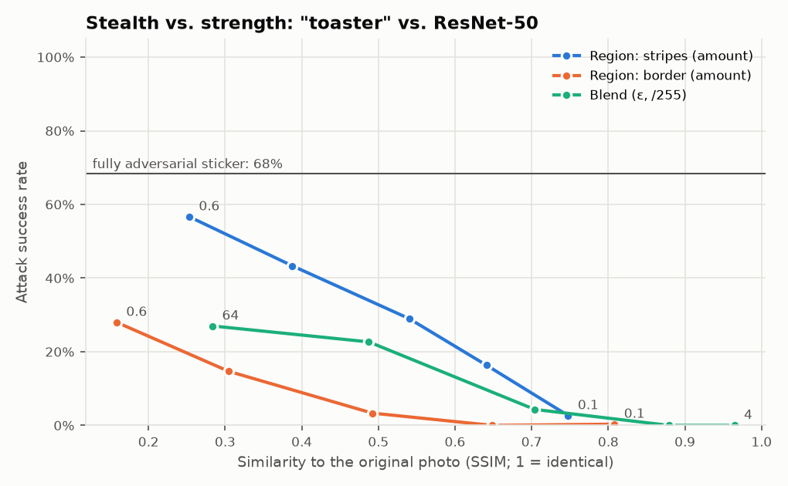
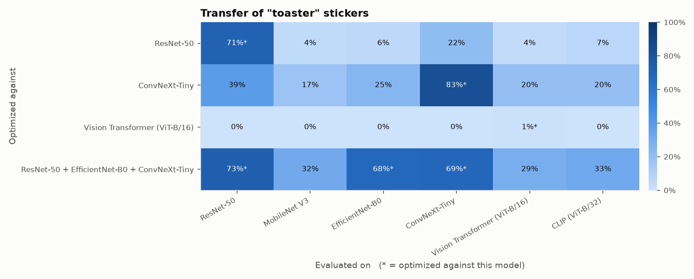

# Results

Evidence for the project's research question (see the [roadmap](ROADMAP.md)):

> How much attack success does an adversarial sticker give up as it is made to look
> more natural, and does that trade-off survive transfer to models it never saw?

Every number below comes from **held-out** photos (Imagenette *val*, 300 photos,
photos of the target class excluded). Conditions are randomized but seeded: random
size (25–45% of the photo width), any rotation, position, perspective tilt, lighting,
contrast, blur, sensor noise and printer color drift. Target: **"toaster"**. All
numbers are simulated; physical results will be added after the photo shoot
([protocol](PHYSICAL_TESTING.md)).

Reproduce with `uv run python experiments/<script>.py` (see
[experiments/README.md](../experiments/README.md)). Raw numbers are in
`docs/results/*/results.csv`.

## 1. Stealth vs. strength

*Can a sticker look like a normal photo and still fool the model?*

The cover photo is a dog (an English springer from Imagenette val). Each point is a
separate sticker optimized for 600 steps against ResNet-50:

- **Region: stripes / border.** The photo is kept exactly, except in diagonal
  stripes or a border ring covering *amount* of the sticker.
- **Blend.** Every pixel of the photo may change by at most ε/255.

Stealth is measured as **SSIM** to the original photo (1 = identical).

| Sticker | Similarity (SSIM) | Says "toaster" | Toaster in top 5 | Correct label lost |
|---|---|---|---|---|
| Fully adversarial (reference) | — | **68%** | 99% | 63% |
| Stripes, 10% | 0.75 | 3% | 30% | 13% |
| Stripes, 20% | 0.64 | 16% | 76% | 23% |
| Stripes, 30% | 0.54 | 29% | 87% | 30% |
| Stripes, 45% | 0.39 | 43% | 96% | 39% |
| Stripes, 60% | 0.25 | **57%** | 98% | 51% |
| Border, 10% | 0.81 | 0% | 1% | 15% |
| Border, 30% | 0.49 | 3% | 22% | 16% |
| Border, 60% | 0.16 | 28% | 91% | 31% |
| Blend, ε = 4/255 | 0.96 | 0% | 0% | 12% |
| Blend, ε = 16/255 | 0.70 | 4% | 38% | 12% |
| Blend, ε = 32/255 | 0.49 | 23% | 74% | 26% |
| Blend, ε = 64/255 | 0.28 | 27% | 76% | 28% |
| *Cover photo alone (control)* | 1.00 | 0% | — | 11% |
| *Random-noise sticker (control)* | — | 0% | — | 9% |

**Findings**

1. **The trade-off is real and steep.** No sticker that stays close to the photo
   (SSIM ≥ 0.7) reaches even 5% top-1 success. Even with 60% of the sticker given
   over to the attack, the best design reaches 57%, 11 points short of the fully
   adversarial sticker.
2. **Where the attack goes matters more than how much.** At equal similarity, stripes
   beat blend, and blend beats a border, across the whole range. A 60% border changes
   more pixels than 60% stripes (84% vs. 64%) yet succeeds half as often (28% vs. 57%).
   Stripes spread adversarial texture across the sticker's whole footprint. A border
   pushes it to the edges, where it is small in the camera's view and gets cut by
   rotation. This matches the size threshold in the full-sticker robustness grid.
3. **Subtle blending saturates.** Doubling the blend budget from 32/255 to 64/255
   barely helps (23% → 27%). The dog photo's own features keep competing, and a
   bounded perturbation can't erase them.
4. **"Almost fooled" comes long before "fooled".** Top-5 success climbs far faster
   than top-1. Stripes at 20% put "toaster" in the top five 76% of the time but win
   only 16%. A system that acts on top-5 candidates, or on a low-confidence
   threshold, is much easier to attack than headline accuracy suggests.
5. **The stealthiest stickers do little beyond covering the scene.** The cover photo
   by itself makes the model lose the correct label 11% of the time, through
   occlusion alone. The most natural-looking stickers (blend ≤ 16/255, stripes 10%)
   reach only 12–13%. Disruption beyond occlusion appears once the attack becomes
   visible: 22% for a 20% border, 51% for 60% stripes.

**Caveats.** One target, one cover photo, one seed, and 600 optimization steps per
sticker. Stripes were the default region because they performed best in early
tests, so they're not an independent discovery. SSIM is a proxy for "looks
normal"; a human rating study would be the stronger measure.

## 2. Transfer and ensembles

*Does a sticker fool models it was never optimized against, and does optimizing
against several models at once help?*

Each row is one fully adversarial circle sticker, optimized for 1000 steps against
the model(s) on the left, then tested on all six models. Starred cells are models the
sticker was optimized against; the rest are transfer.

| Optimized against | ResNet-50 | MobileNet V3 | EfficientNet-B0 | ConvNeXt-T | ViT-B/16 | CLIP |
|---|---|---|---|---|---|---|
| ResNet-50 | **71%*** | 4% | 6% | 22% | 4% | 7% |
| ConvNeXt-Tiny | 39% | 17% | 25% | **83%*** | 20% | 20% |
| ViT-B/16 | 0% | 0% | 0% | 0% | 1%* | 0% |
| ResNet-50 + EfficientNet-B0 + ConvNeXt-T | **73%*** | 32% | **68%*** | **69%*** | 29% | 33% |

Controls: with no sticker, or with a random-noise sticker of the same shape, no model
says "toaster" on any of these photos (0% in every column). So every nonzero transfer
number above is the sticker's doing.

**Findings**

1. **Single-model stickers transfer weakly, and unevenly.** The ResNet-50 sticker
   fools ResNet-50 71% of the time but other models only 4–22%. The ConvNeXt
   sticker transfers better (17–39%). In both directions the closest relative gains
   most: ConvNeXt from the ResNet sticker (22%), ResNet from the ConvNeXt sticker (39%).
2. **Ensembles transfer much better at almost no cost.** Optimizing against three CNNs
   at once keeps 68–73% on each of them (ResNet-50 alone: 71%). On the three models it
   never saw it reaches 29–33%, against 4–20% for the single-model stickers. This is
   the usual way real attackers get around not knowing which model is deployed. It's
   also why "we use a different model" is weak protection on its own.
3. **Our attack failed against ViT-B/16, even with full access to it.** The sticker
   optimized against the vision transformer fooled it on 1% of photos. During
   optimization its target probability stayed around 5% or lower (averaged over 50
   steps); the CNN stickers reached 50–65%. This is a limitation of our settings, which
   were tuned on CNNs (learning rate, smoothness penalty, transformations). It isn't
   evidence that transformers are robust. CLIP is also a vision transformer, and in a
   separate quick run a CLIP sticker for "a bowl of ramen" fooled it on 74% of photos.
   Published work reports successful patch attacks on ViTs with methods designed for
   them (e.g. Patch-Fool, Fu et al., ICLR 2022).
4. **CLIP loses the right answer easily, so its numbers need the control.** A
   random-noise sticker alone makes CLIP drop the correct label on 31% of photos,
   far more than any other model (4–16%). The ensemble sticker's 58% on CLIP is
   therefore about 27 points of real effect, not 58.

**Caveats.** One target, one seed, one shape, simulated photos, 300 held-out photos
per cell. The ViT result depends on attack settings we didn't tune for ViTs.

## 3. Defenses

See the defense-mode PR / `adai-sticker defend`: on the full "toaster" sticker, a
Grad-CAM-based patch detector cuts success from 67% to 4% at a 4-point clean-accuracy
cost. Blur cuts success to 42%, but an adaptive attacker restores it to 71%.
