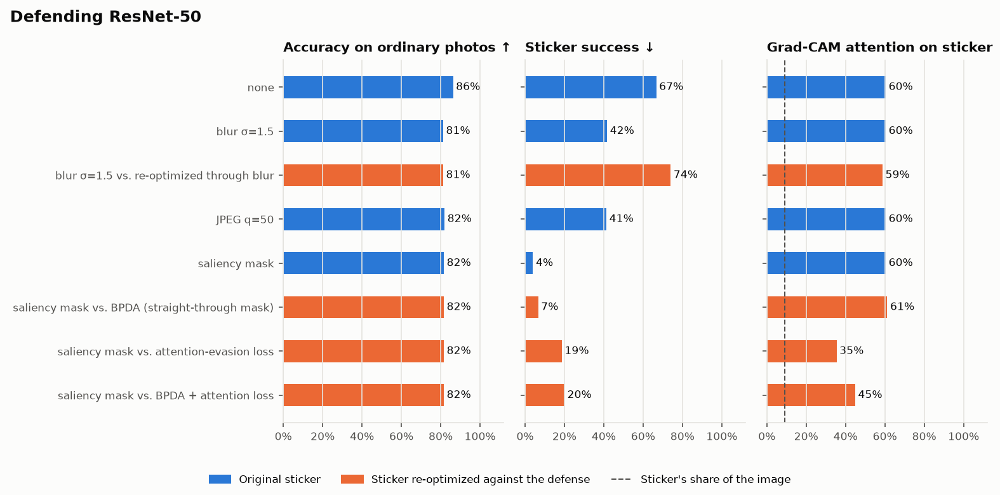

# Defending ResNet-50 against the "toaster" sticker

| Defense | Attacker | Clean accuracy | Sticker success | Correct label lost | Flagged (sticker / clean) | Attention on sticker |
|---|---|---|---|---|---|---|
| none | original sticker | 86% | 67% | 61% | — | 60% |
| blur σ=1.5 | original sticker | 81% | 42% | 41% | — | 60% |
| blur σ=1.5 | adaptive: re-optimized through blur | 81% | 74% | 68% | — | 59% |
| JPEG q=50 | original sticker | 82% | 41% | 39% | — | 60% |
| saliency mask | original sticker | 82% | 4% | 17% | 69% / 12% | 60% |
| saliency mask | adaptive: BPDA (straight-through mask) | 82% | 7% | 17% | 65% / 12% | 61% |
| saliency mask | adaptive: attention-evasion loss | 82% | 19% | 25% | 17% / 12% | 35% |
| saliency mask | adaptive: BPDA + attention loss | 82% | 20% | 28% | 38% / 12% | 45% |

**Reading this table.** A good defense lowers sticker success without lowering clean accuracy. The *adaptive* rows re-optimize the sticker knowing the defense is there. Defenses that only look strong against the original sticker often fail once the attacker adapts: an arms race.

Clean accuracy is measured on the held-out Imagenette photos (10 classes) as a 1,000-way ImageNet prediction. The saliency defense's trigger threshold is calibrated on training photos so about 10% of clean photos get masked. *Attention on sticker* is the share of the target's Grad-CAM mass that falls on the sticker in 48 held-out photos, where the sticker covers 9% of the image.

## Adaptive attacks on the saliency detector

Each attacker starts from the original sticker and re-optimizes it for 1000 steps on training photos, knowing the detector and its threshold (attention weight 30, sigmoid temperature 0.05):

- **BPDA (straight-through mask)**: optimize the *defended* prediction. The forward pass is the real detector; the backward pass swaps its two hard thresholds for sigmoids, so the gradient says how to move or shrink the masked hotspot (Athalye, Carlini & Wagner, 2018).
- **Attention-evasion loss**: keep the *undefended* prediction on target while penalizing the share of Grad-CAM attention on the sticker.
- **BPDA + attention loss**: the attention attack, also optimizing the defended prediction through the straight-through mask.

| Sticker | Attention on sticker | Flagged | Success with detector | Success without detector |
|---|---|---|---|---|
| original | 60% | 69% | 4% | 67% |
| adaptive: BPDA (straight-through mask) | 61% | 65% | 7% | 62% |
| adaptive: attention-evasion loss | 35% | 17% | 19% | 25% |
| adaptive: BPDA + attention loss | 45% | 38% | 20% | 52% |

The detector costs 4.7 points of clean accuracy (86.3% → 81.6%) whichever sticker it faces. Against the original sticker it holds success to 4% (undefended: 67%). The strongest adaptive attack here (BPDA + attention loss) reaches 20%, and the detector flags 38% of its photos (clean photos: 12%).
Evading the detector cost the sticker strength: without the detector it now succeeds 52% of the time, down from 67%.

## Does sticker size matter to the saliency detector?

The original sticker at fixed widths (share of the photo's width), with random rotation and position. The sticker was optimized and tested at widths of 25%–45%.

| Sticker width | Success without detector | Success with detector | Flagged |
|---|---|---|---|
| 25% | 16% | 3% | 21% |
| 35% | 75% | 3% | 78% |
| 45% | 91% | 3% | 92% |
| 55% | 96% | 40% | 60% |
| 65% | 99% | 94% | 5% |

The detector grays out the top 12% of Grad-CAM pixels plus a margin, which is more than a small sticker covers. A sticker big enough to spread the model's attention over a larger area no longer looks *concentrated*, so the detector stops firing.
