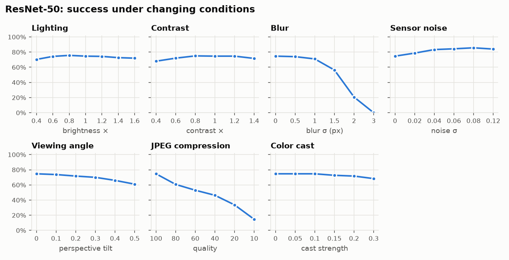
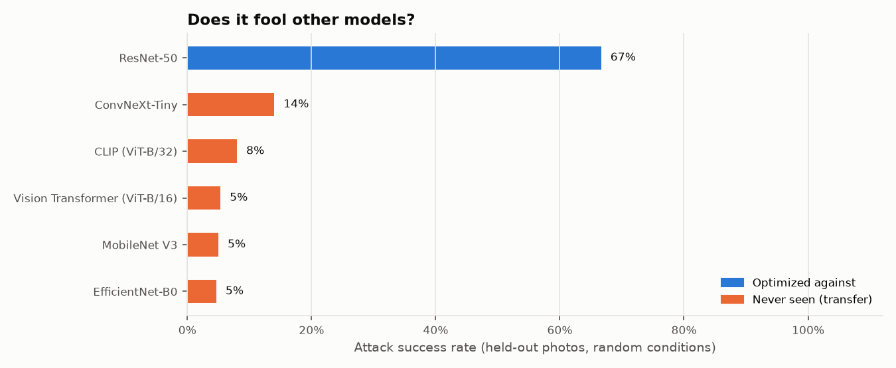

# Sticker report: "toaster" vs. ResNet-50

**Bottom line:** across 300 held-out photos with random size, rotation, position, lighting, blur and print color drift, ResNet-50 labeled the scene **"toaster" 67%** of the time with this sticker, versus 0% with no sticker and 0% with a random-noise sticker of the same shape.

Even when the target label wasn't reached, the sticker made the model lose a correct answer 61% of the time.

## What was made

- **Target label:** toaster
- **Optimized against:** ResNet-50
- **Shape:** circle
- **Cover mode:** none (the whole sticker is adversarial)
- **Colors:** unconstrained RGB
- **Changed from cover photo:** 100% of pixels, mean change 0.0/255
- **Optimization:** 1000 steps in 0 s

## Controls

| Condition | Labeled as target | Top-5 contains target | Correct label lost |
|---|---|---|---|
| no sticker | 0% | 0% | 0% |
| random-noise sticker | 0% | 0% | 9% |
| adversarial sticker | 67% | 100% | 61% |

## Rotation and size

- The sticker succeeds on at least half of photos once it is 30% of the photo's width or larger (averaged over every rotation).
- Rotation matters less than size: averaged over sizes, success ranges from 50% (at -90°) to 53% (at 30°).

## Imaging conditions

Each row varies one factor from mild to severe (sticker at 35% of photo width, random rotation).

| Factor | Values | Success rate |
|---|---|---|
| Lighting | 0.4, 0.6, 0.8, 1, 1.2, 1.4, 1.6 | 70%, 74%, 76%, 75%, 74%, 73%, 72% |
| Contrast | 0.4, 0.6, 0.8, 1, 1.2, 1.4 | 68%, 72%, 75%, 75%, 75%, 72% |
| Blur | 0, 0.5, 1, 1.5, 2, 3 | 75%, 74%, 71%, 56%, 21%, 0% |
| Sensor noise | 0, 0.02, 0.04, 0.06, 0.08, 0.12 | 75%, 79%, 83%, 84%, 86%, 84% |
| Viewing angle | 0, 0.1, 0.2, 0.3, 0.4, 0.5 | 75%, 74%, 72%, 70%, 66%, 61% |
| JPEG compression | 100, 80, 60, 40, 20, 10 | 75%, 61%, 53%, 46%, 34%, 15% |
| Color cast | 0, 0.05, 0.1, 0.15, 0.2, 0.3 | 75%, 75%, 75%, 73%, 72%, 68% |

## Transfer to other models

| Model | Optimized against? | Labeled as target | Correct label lost |
|---|---|---|---|
| ResNet-50 | yes | 67% | 61% |
| MobileNet V3 | no | 5% | 23% |
| EfficientNet-B0 | no | 5% | 35% |
| ConvNeXt-Tiny | no | 14% | 13% |
| Vision Transformer (ViT-B/16) | no | 5% | 11% |
| CLIP (ViT-B/32) | no | 8% | 33% |

## Where the model looks

The sticker covers 9% of each photo but receives **60%** of the model's attention (Grad-CAM) for the target class — 6.5x more than its size alone would predict.

## Limitations

- These numbers come from *simulated* photos. Printing and photographing the sticker is the real test; use the print sheet and `adai-sticker eval-photos` to measure it.
- The simulator's printer model is a generic approximation, not a calibrated profile of a specific printer.
- Success against one model does not imply success against others; see the transfer table.
- Results depend on the background photos; Imagenette covers only 10 everyday categories.

## Responsible use

This sticker was made to teach how fragile image classifiers can be. Labels that could endanger or demean people are blocked by the pipeline's safety policy. Please don't use adversarial stickers to deceive safety-critical systems or to harm, harass, or misidentify anyone.
